

# APH Search

*Search settings, keybinds, add-ons, items, skills, champion stars, the map, quests, achievements, menus and slash commands, and jump straight to what you picked. When it's a place, it offers the closest way to travel there.*

## Dependencies

Requires **LibAPH** (shared helper library, hard dependency).

Optionals for additional features:
- **LibAddonMenu-2.0:** required for the PC Settings Menu.
- **LibHarvensAddonSettings:** required for the Console Settings Menu.

Without the optional dependencies, the addon still runs entirely independently and can be controlled via built-in slash commands as a standalone utility.

## Demos

<b>PC</b>

**Settings**

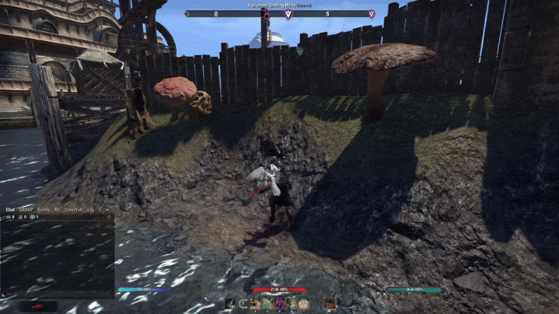

**Search bar position**

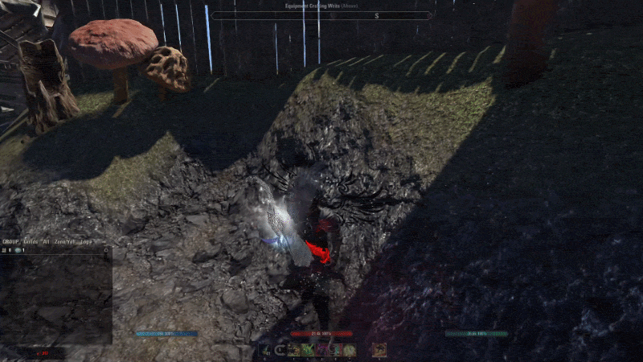

**Deleting search history**

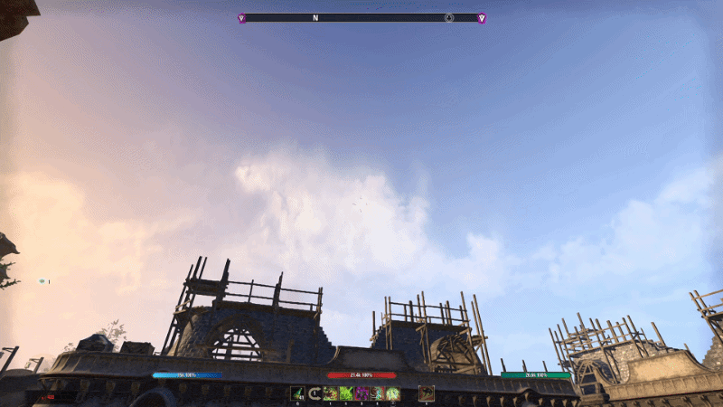

**Search Add-ons & Game Settings**

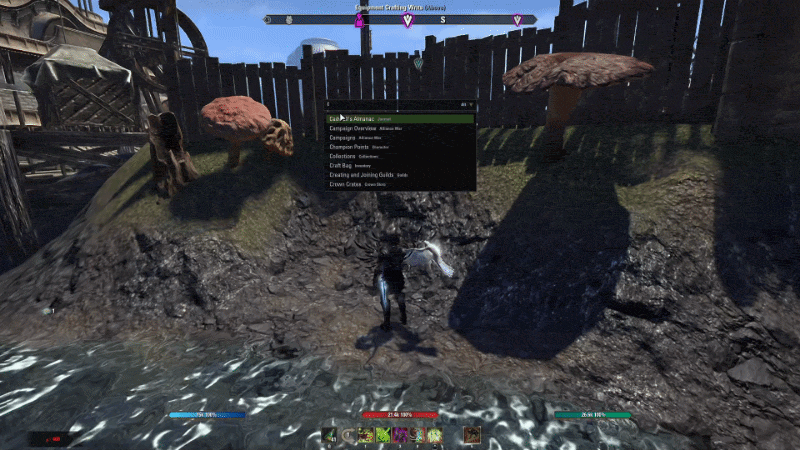

**Achievement search**

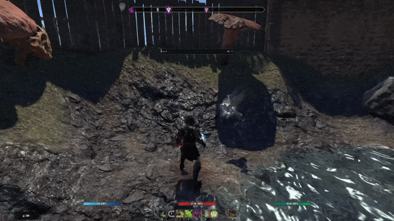

**Collectible search and use**

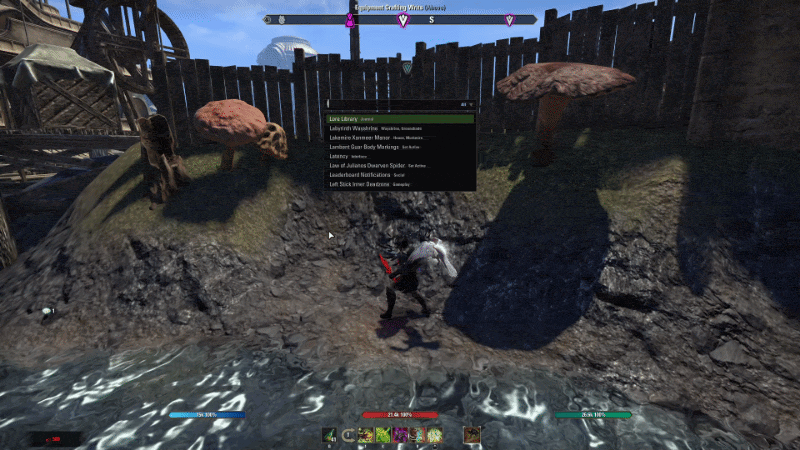

**Champion Point search**

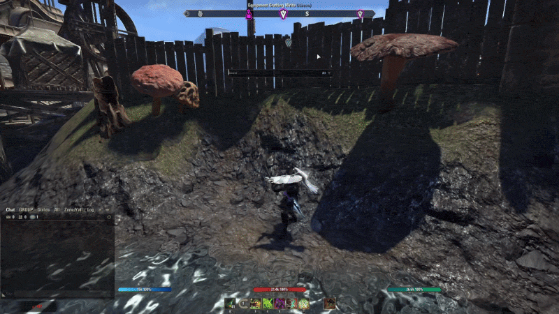

**Crown Store search**

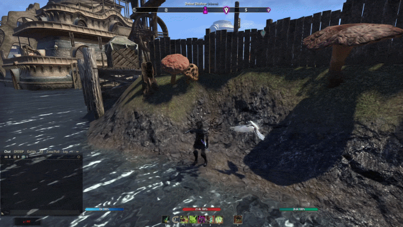

**Feedback and report search**

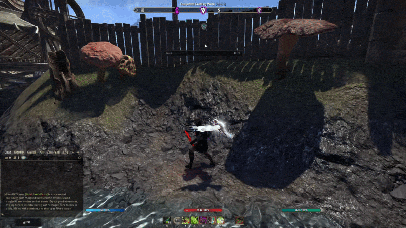

**Item set search**

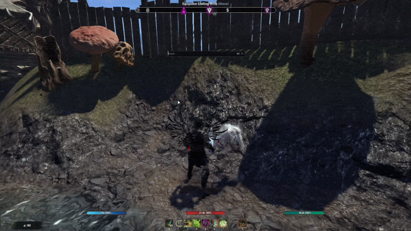

**Map search**

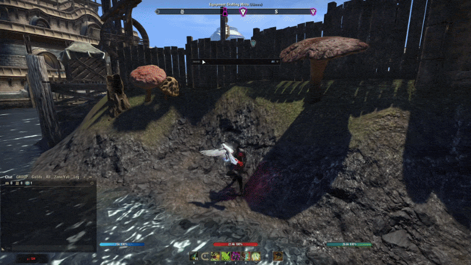

**Outfit style search**

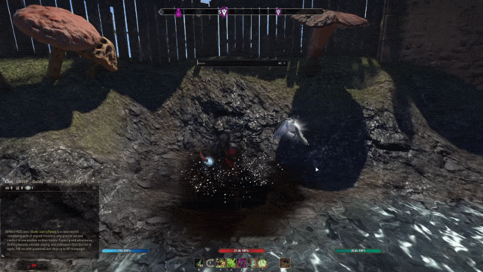

**Quest search with location suggestion**

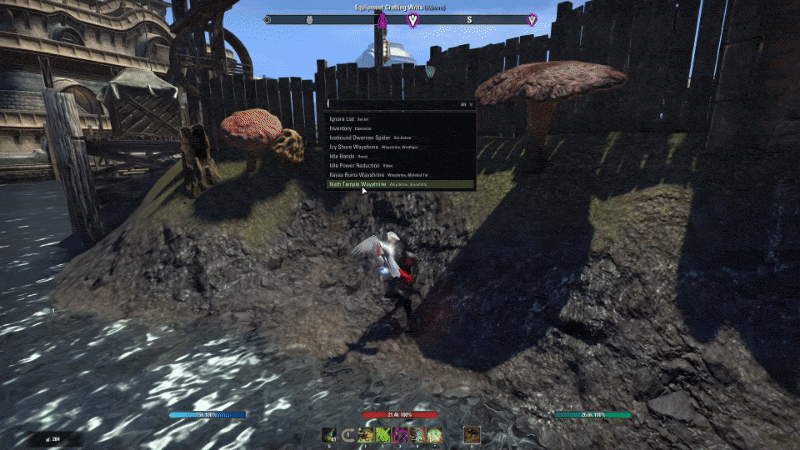

**Skill search**

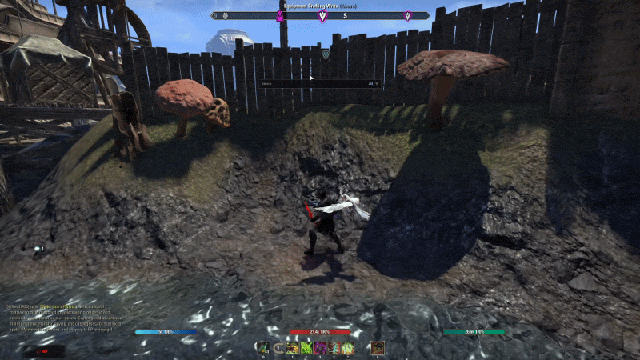

**And many more...**

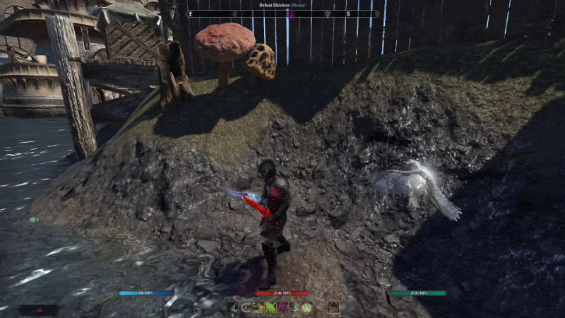

<b>Console</b>

**Dungeon and quest search**

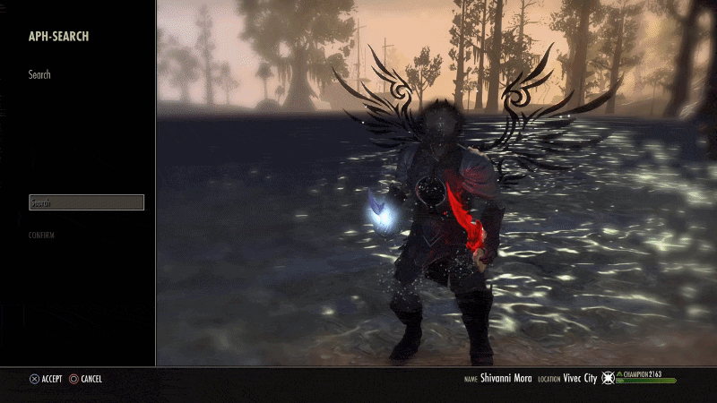

**Feedback and report search**

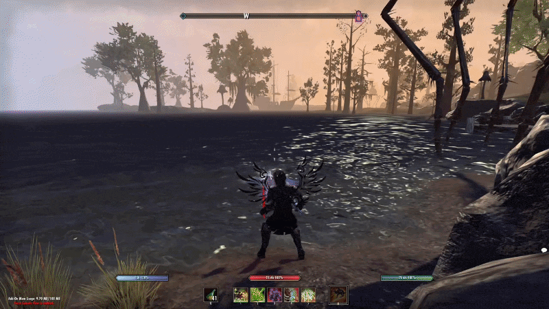

**Map search**

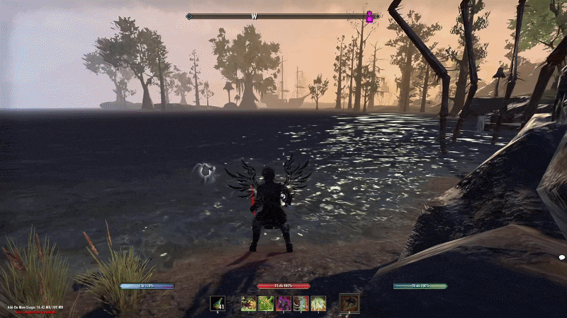

## Slash Commands

- `/fs`: opens the search bar.

> [!WARNING]
> **Console Testing Notes:** This addon was developed and tested on **PC / Steam Deck** *(using Force Console Flow for console testing)*.

## License

Copyright © 2026 @APHONlC. All rights reserved. See LICENSE.md

> [!NOTE]
> This add-on is not created by, affiliated with, or sponsored by ZeniMax Media Inc. or its affiliates. The Elder Scrolls® and related logos are registered trademarks or trademarks of ZeniMax Media Inc. in the United States and/or other countries. All rights reserved.

For permissions or inquiries, contact @APHONlC on ESOUI.

## Credits

I would like to thank the following, for providing resources and their awesome projects:

- [ESOUI Wiki](https://wiki.esoui.com/Main_Page)
- [@sirinsidiator](https://github.com/esoui/esoui)
- [@Flat-Badger-1971](https://github.com/Flat-Badger-1971/eso-api)
- [@sirinsidiator & @Seerah](https://www.esoui.com/downloads/info7.html) *(LibAddonMenu-2.0)*
- [@Harven & @votan](https://www.esoui.com/downloads/info584.html) *(LibHarvensAddonSettings)*
- [@SinusPi, @merlight, @Rhyono, @Dolgubon](https://www.esoui.com/downloads/info1624.html) *(Zgoo High Isle)*
- [@Baertram](https://www.esoui.com/downloads/info2601.html) *(Mer Torchbug - Fixed and Improved "Variable inspector/Scripts/Events/and more")*

**Testers & Suggestions:**

<!-- TESTERS:START -->
- @Drakius192
<!-- TESTERS:END -->

**Check out my other addons/projects:**

- [Auto Lua Memory Cleaner](https://www.esoui.com/downloads/fileinfo.php?id=4388#info)
- [Permanent Memento](https://www.esoui.com/downloads/fileinfo.php?id=4116#info)
- [Tamriel Trade Center, HarvestMap, ESO-Hub, ESOUI Auto-Updater](https://www.esoui.com/downloads/fileinfo.php?id=3249#info) *(Linux, macOS, SteamDeck, & Windows)*

If you like the addon and are considering donating, here's a link. Thank you!

### Bug Reports

If you encounter any issues, please submit a report here
